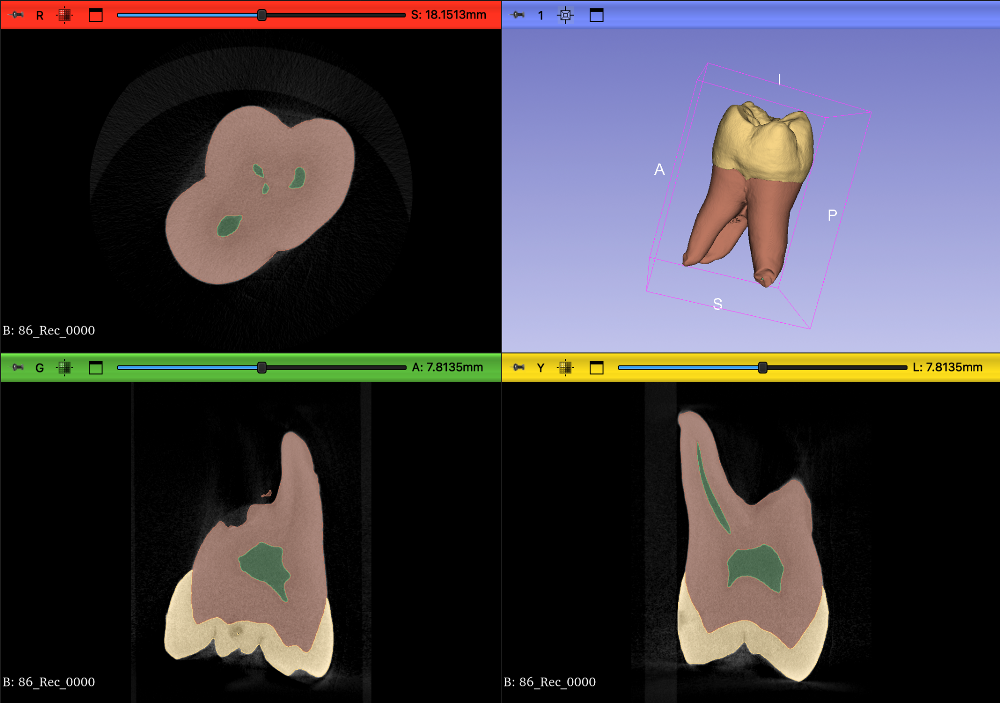
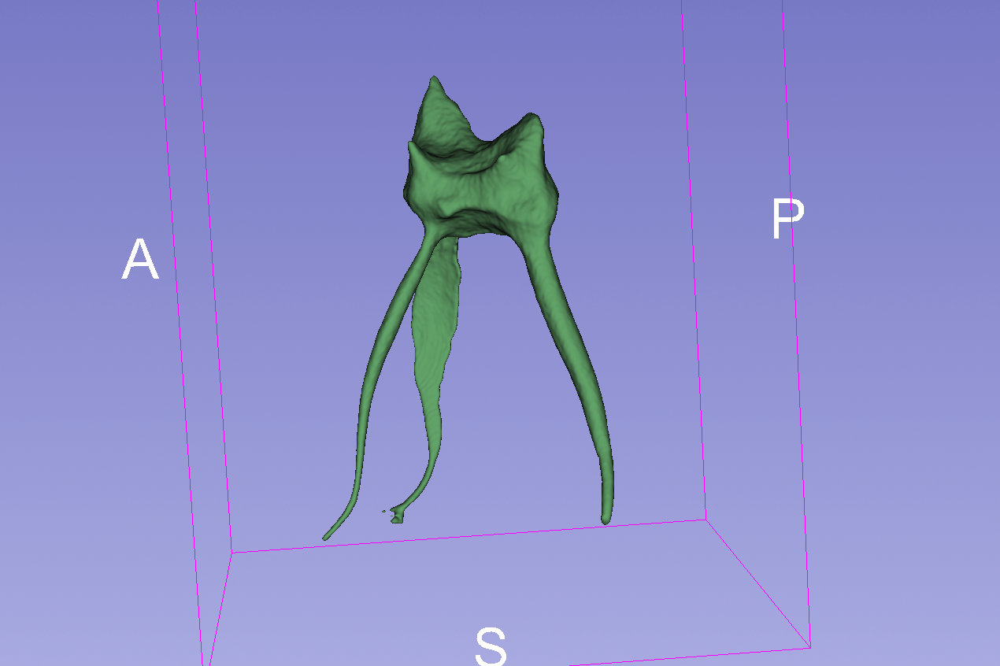

# Micro-CT Tooth Tissue Segmentation

Three-dimensional segmentation of **enamel, dentin, and the pulp cavity** in ex vivo tooth micro-computed tomography (micro-CT) images using **nnU-Net v2**. The model generates tissue-specific masks for extracted teeth, including the pulp chamber and root canals.

## Segmentation examples

The examples below show micro-CT segmentation overlays and three-dimensional reconstructions of the predicted tissue structures.

| Micro-CT segmentation: axial, coronal, sagittal, and 3D views | Three-dimensional pulp cavity and root canals |
|:---:|:---:|
|  |  |

## Model overview

| Property | Value |
|---|---|
| Framework | nnU-Net v2 |
| Dataset | `Dataset413_microctbycsm` (ID `413`) |
| Configuration | `3d_fullres` |
| Trainer | `nnUNetTrainer` |
| Available fold | `0` (`checkpoint_final.pth`) |
| Input | Single-channel micro-CT, NIfTI `.nii.gz` |
| Preprocessing target spacing | Approximately 0.0418 mm isotropic |
| Segmentation classes | Pulp cavity, enamel, dentin |
| Dataset entries recorded | 100 |
| Fold 0 internal validation | 20 cases |

The model predicts integer labels for each voxel. See [label definitions](docs/LABELS.md) for the full mapping.

## Model availability

**The trained model weights are available upon reasonable request for academic and research purposes.**

To request the pretrained nnU-Net model, please email **[simaichen413@gmail.com](mailto:simaichen413@gmail.com)** with a brief description of your research purpose.

The model is supplied as an nnU-Net v2-compatible ZIP archive (`Dataset413_model.zip`). Once received, it can be installed directly using:

```bash
nnUNetv2_install_pretrained_model_from_zip /path/to/Dataset413_model.zip
```

## Installation and inference

Install nnU-Net v2 in a compatible Python / PyTorch environment:

```bash
pip install nnunetv2
```

Configure a writable nnU-Net results directory (macOS/Linux example):

```bash
export nnUNet_results="$HOME/nnUNet_results"
mkdir -p "$nnUNet_results"
```

After importing the model archive, prepare single-channel micro-CT NIfTI images with the nnU-Net naming convention:

```text
imagesTs/
├── tooth001_0000.nii.gz
└── tooth002_0000.nii.gz
```

Run segmentation with Fold 0:

```bash
nnUNetv2_predict \
  -i ./imagesTs \
  -o ./predictions \
  -d Dataset413_microctbycsm \
  -c 3d_fullres \
  -f 0 \
  -tr nnUNetTrainer
```

Predictions are saved as multiclass NIfTI masks (`tooth001.nii.gz`, etc.). See [Installation](docs/INSTALLATION.md) or [中文使用说明](docs/使用说明_中文.md) for full instructions and Windows commands.

## Internal validation

Internal validation was performed on 20 ex vivo tooth micro-CT scans (Fold 0). The exported nnU-Net validation summary reports:

| Structure | Mean Dice | Mean IoU |
|---|---:|---:|
| Pulp cavity | 0.9528 | 0.9133 |
| Enamel | 0.9693 | 0.9429 |
| Dentin | 0.9827 | 0.9663 |
| **Foreground-class mean** | **0.9683** | **0.9408** |

These are internal validation results for Fold 0. The full per-class metrics are available in [Validation](docs/VALIDATION.md) and [`metadata/validation_by_label.csv`](metadata/validation_by_label.csv).

## Repository structure

```text
MicroCT-Tooth-Tissue-Segmentation/
├── README.md
├── .gitignore
├── assets/
│   └── examples/
│       ├── microct_multiplanar_segmentation.png
│       └── pulp_cavity_3d_reconstruction.png
├── docs/
│   ├── INSTALLATION.md
│   ├── LABELS.md
│   ├── MODEL.md
│   ├── VALIDATION.md
│   └── 使用说明_中文.md
├── metadata/
│   ├── dataset.json
│   ├── labels.json
│   ├── model.json
│   └── validation_by_label.csv
├── model/
│   └── README.md
└── scripts/
    ├── check_model_zip.py
    ├── predict.sh
    └── predict.ps1
```

## Reference

Isensee F, Jaeger PF, Kohl SAA, Petersen J, Maier-Hein KH. nnU-Net: a self-configuring method for deep learning-based biomedical image segmentation. *Nature Methods*. 2021;18:203–211. https://doi.org/10.1038/s41592-020-01008-z
