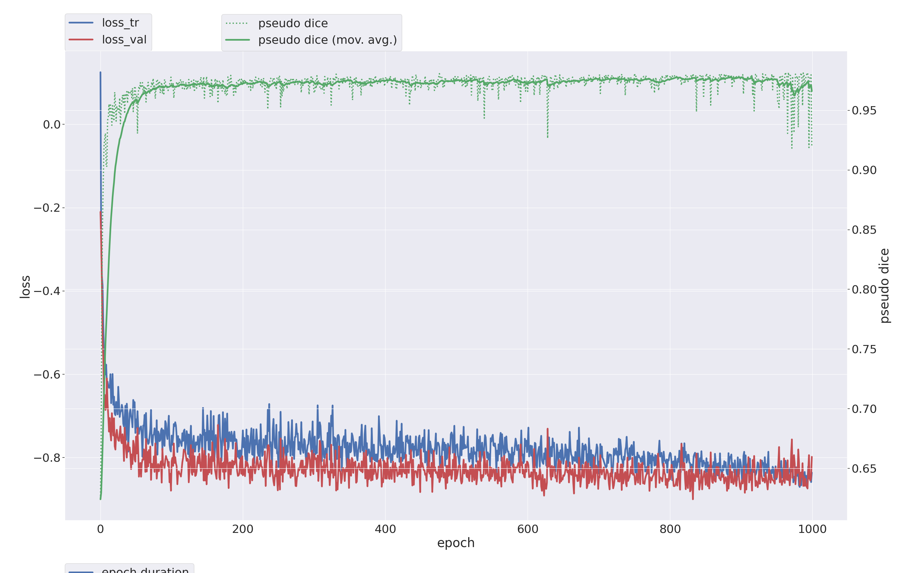

# Micro-CT Tooth Tissue Segmentation

**Automated segmentation of enamel, dentin, and the pulp cavity in ex vivo tooth micro-computed tomography (micro-CT) images using nnU-Net v2.**

This repository provides model documentation, label definitions, internal validation results, and inference scripts for three-dimensional tissue segmentation of extracted teeth.

## Segmentation targets

| Label ID | Anatomical structure | Model label |
|---:|---|---|
| 0 | Background | `background` |
| 1 | Pulp cavity | `pulp_cavity` |
| 2 | Enamel | `enamel` |
| 3 | Dentin | `dentin` |

The network predicts a **multiclass 3D segmentation**: each voxel is assigned a single integer label. It distinguishes the three tooth tissue compartments within an individual micro-CT volume.

## Model overview

| Property | Specification |
|---|---|
| Framework | nnU-Net v2 |
| Dataset | `Dataset413_microctbycsm` (ID `413`) |
| Configuration | `3d_fullres` |
| Trainer | `nnUNetTrainer` |
| Available fold | `0` (`checkpoint_final.pth`) |
| Image format | Single-channel `.nii.gz` (CT) |
| Target preprocessing spacing | approximately **0.0418 mm** in each dimension (from model plans) |
| Dataset entries recorded in `dataset.json` | 100 |
| Fold 0 internal validation cases | 20 |

## Internal validation

The following scores were calculated from the model's exported Fold 0 validation summary:

| Structure | Mean Dice | Mean IoU |
|---|---:|---:|
| Pulp cavity | 0.9528 | 0.9133 |
| Enamel | 0.9693 | 0.9429 |
| Dentin | 0.9827 | 0.9663 |
| **Foreground-class mean** | **0.9683** | **0.9408** |

These are internal validation results for the supplied Fold 0 model. See [validation details](docs/VALIDATION.md) and [full metrics](metadata/validation_by_label.csv).

## Training history

The following chart is extracted from the exported nnU-Net training record; it shows training/validation loss, pseudo Dice, epoch duration, and learning-rate progression.



[View the full training history](assets/training/progress.png)

## Model availability

**The trained model weights are available upon reasonable request for academic and research purposes.**

For access to the pretrained nnU-Net model, please email **[simaichen413@gmail.com](mailto:simaichen413@gmail.com)** with a brief description of your research purpose.

The model is supplied as a standard nnU-Net v2-compatible ZIP file (`Dataset413_model.zip`). Once received, install it directly:

```bash
nnUNetv2_install_pretrained_model_from_zip /path/to/Dataset413_model.zip
```

## Installation and inference

Install a compatible nnU-Net v2 / PyTorch environment:

```bash
pip install nnunetv2
```

Configure `nnUNet_results` (macOS/Linux example):

```bash
export nnUNet_results="$HOME/nnUNet_results"
mkdir -p "$nnUNet_results"
```

After importing the pretrained ZIP, place single-channel micro-CT NIfTI volumes in an input directory:

```text
imagesTs/
├── tooth001_0000.nii.gz
└── tooth002_0000.nii.gz
```

Run inference using the provided fold:

```bash
nnUNetv2_predict \
  -i ./imagesTs \
  -o ./predictions \
  -d Dataset413_microctbycsm \
  -c 3d_fullres \
  -f 0 \
  -tr nnUNetTrainer
```

Outputs are multiclass NIfTI masks (`tooth001.nii.gz`, etc.) with the labels listed above. For a detailed guide and Windows commands, see [Installation](docs/INSTALLATION.md) or [中文使用说明](docs/使用说明_中文.md).

## Repository layout

```text
MicroCT-Tooth-Tissue-Segmentation/
├── README.md
├── .gitignore
├── assets/
│   ├── training/
│   │   ├── training_curve.png
│   │   └── progress.png
│   └── examples/
│       └── README.md
├── docs/
│   ├── INSTALLATION.md
│   ├── MODEL.md
│   ├── VALIDATION.md
│   ├── LABELS.md
│   └── 使用说明_中文.md
├── metadata/
│   ├── dataset.json
│   ├── labels.json
│   ├── model.json
│   └── validation_by_label.csv
├── model/
│   └── README.md
└── scripts/
    ├── check_model_zip.py
    ├── predict.sh
    └── predict.ps1
```

## Reference

Isensee F, Jaeger PF, Kohl SAA, Petersen J, Maier-Hein KH. nnU-Net: a self-configuring method for deep learning-based biomedical image segmentation. *Nature Methods*. 2021;18:203–211. https://doi.org/10.1038/s41592-020-01008-z
